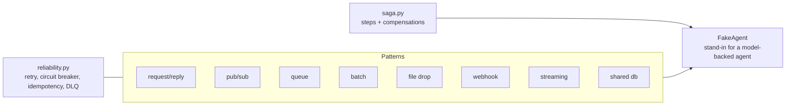

# Jagadish-agentic-integration

[](https://github.com/jagadishmazure-jpg/Jagadish-agentic-integration/actions/workflows/ci.yml)
[](https://github.com/jagadishmazure-jpg/Jagadish-agentic-integration/actions/workflows/codeql.yml)


**Eight enterprise integration patterns with an AI agent as the endpoint (request/reply, pub/sub, queue, batch, file drop, webhook, streaming, shared database), plus a saga, with the reliability pieces each one needs. Offline and deterministic.**

> Personal learning and portfolio project. Everything runs offline on synthetic,
> fictional data with no API keys. Nothing is deployed. Numbers in this README
> come from real runs and are re-checked by CI (`scripts/render_docs.py --check`).

## Recruiter summary

- Shows how an agent plugs into existing systems the way any service does: timeouts and fallbacks, idempotency, dead-letter queues, checkpoints, signatures, optimistic locking and compensation.
- Real run: a timed-out agent degrades instead of failing, a poison message goes to the dead-letter queue, a 250-item batch resumes from its checkpoint, a forged webhook is rejected, a stale write is refused, and a failed saga compensates its two completed steps.
- Includes a bug fix from my own review: a resumed batch kept stale errors from the interrupted run; now cleared on success, with a test.

## Purpose

Forward-deployed work is mostly integration: the agent has to sit behind a
queue, answer a webhook, or process a nightly file drop without breaking the
system around it. This repo puts a stand-in agent at the end of each common
pattern so the failure handling can be tested without a model or a broker.

## Architecture



## How it works

**Agents** (`agentint/agents.py`): deterministic stand-ins that can be made
slow or failing on purpose.

**Reliability** (`agentint/reliability.py`): retry with backoff, circuit
breaker, idempotency store and dead-letter queue with reason codes, shared by
all patterns.

**Patterns** (`agentint/patterns/`): one module each. Request/reply has a
timeout and a degraded answer; the queue acks, retries and dead-letters;
batch checkpoints and resumes; file drop skips files it has seen; webhook
checks an HMAC signature and deduplicates; streaming windows events; shared
database uses version numbers to refuse stale writes.

**Saga** (`agentint/saga.py`): runs steps in order and, on failure, runs the
compensations of completed steps in reverse. Catalogue:
[docs/pattern-catalog.md](docs/pattern-catalog.md).

## Real code and output

```python
"""All 8 integration patterns plus a saga, each with an agent as the endpoint.

Deterministic and offline: FakeAgent stands in for a model-backed agent, and
files go to a temporary folder that is deleted afterwards.
"""
import json
import tempfile
from pathlib import Path

from agentint import FakeAgent
from agentint.patterns.batch import AgentBatchRunner, BatchInterrupted
from agentint.patterns.filedrop import DropFolderAgent
from agentint.patterns.pubsub import AgentTopicBus
from agentint.patterns.queue import AgentWorkQueue
from agentint.patterns.request_reply import SyncAgentEndpoint
from agentint.patterns.sharedb import SharedStoreAgent, VersionConflict
from agentint.patterns.streaming import AgentStreamConsumer
from agentint.patterns.webhook import AgentWebhookReceiver, BadSignatureError
from agentint.saga import OrchestratedSaga, SagaFailed

# 1. Request/reply: primary agent fails, fallback answers in degraded mode.
primary = FakeAgent("classifier", "classifier", should_fail=lambda p: True)
fallback = FakeAgent("fallback", "classifier", behavior=lambda p: {"label": "unknown", "degraded": True})
ep = SyncAgentEndpoint(primary, fallback_agent=fallback, timeout_ms=500)
r = ep.request({"doc": "invoice"}, correlation_id="trace-1")
print("1 request/reply:", r["status"], r.get("result"))

# 2. Pub/sub: one event, two subscribers, nothing blocks the publisher.
bus = AgentTopicBus()
notifier, auditor = FakeAgent("notifier", "notify"), FakeAgent("auditor", "audit")
bus.subscribe(notifier, "order.*")
bus.subscribe(auditor, "*")
print("2 pub/sub: delivered to", bus.publish("order.created", {"id": 7}), "subscribers;",
      "notifier pending", bus.pending(notifier))

# 3. Queue: competing consumers, a poison message goes to the DLQ.
workers = [FakeAgent(f"w{i}", "worker", should_fail=lambda p: p.get("poison", False)) for i in (1, 2)]
q = AgentWorkQueue(workers)
for i in range(3):
    q.enqueue({"task": "extract", "n": i}, message_id=f"m{i}")
q.enqueue({"poison": True}, message_id="bad")
print("3 queue:", q.dispatch())

# 4. Batch with checkpoint/resume: crash on record 150, resume finishes the rest.
with tempfile.TemporaryDirectory() as tmp:
    ck = Path(tmp) / "ck.json"
    crash = {"on": True}
    agent = FakeAgent("transformer", "batch", should_fail=lambda p: crash["on"] and p == 150)
    runner = AgentBatchRunner(agent, chunk_size=100, checkpoint_path=ck)
    try:
        runner.run(list(range(250)))
    except BatchInterrupted:
        print("4 batch: interrupted, checkpoint", json.loads(ck.read_text()))
    crash["on"] = False
    print("4 batch: resumed ->", runner.run(list(range(250)), resume=True))

    # 5. File drop: duplicate content is skipped by checksum.
    inbox = Path(tmp) / "inbox"
    drop = DropFolderAgent(FakeAgent("filer", "classifier"), inbox, Path(tmp) / "done", Path(tmp) / "error")
    (inbox / "a.txt").write_text("claim 1")
    print("5 file drop: first poll", drop.poll())
    (inbox / "a-copy.txt").write_text("claim 1")
    print("5 file drop: duplicate poll", drop.poll())

# 6. Webhook: bad signature rejected, duplicate delivery returns the stored result.
hook = AgentWebhookReceiver(FakeAgent("triage", "triage"), secret=b"demo-secret-not-real")
body = b'{"event": "ticket.opened"}'
try:
    hook.receive(body, "forged", "k1")
except BadSignatureError as e:
    print("6 webhook:", e)
print("6 webhook:", hook.receive(body, hook.sign(body), "k1")["status"], "then",
      hook.receive(body, hook.sign(body), "k1")["status"])

# 7. Streaming: out-of-order events sorted by event time into tumbling windows.
stream = AgentStreamConsumer(FakeAgent("agg", "aggregate", behavior=lambda p: {"times": p["event_times"]}),
                             window_size=3)
for t in [5, 1, 3, 2, 6, 4]:
    stream.append(t, {"v": t})
print("7 streaming windows:", [w["times"] for w in stream.run()])

# 8. Shared database (anti-pattern): a stale write is refused, not lost.
store = SharedStoreAgent()
v = store.write("limit", 100, expected_version=0)
try:
    store.write("limit", 200, expected_version=0)
except VersionConflict as e:
    print("8 shared db: stale write refused:", e)

# Saga: the third step fails, earlier steps are compensated in reverse order.
log = []
saga = OrchestratedSaga("booking")
saga.add_step("reserve", lambda c: log.append("reserve"), lambda c: log.append("undo reserve"))
saga.add_step("charge", lambda c: log.append("charge"), lambda c: log.append("refund"))
saga.add_step("ship", lambda c: (_ for _ in ()).throw(RuntimeError("carrier down")), lambda c: None)
try:
    saga.run({})
except SagaFailed as e:
    print("saga:", e, "| log:", log)
```

Output of `python examples/demo.py` (real run, re-checked in CI):

<!-- run: python examples/demo.py -->
```text
1 request/reply: degraded {'label': 'unknown', 'degraded': True}
2 pub/sub: delivered to 2 subscribers; notifier pending 1
3 queue: {'acked': ['m0', 'm1', 'm2'], 'dead_lettered': 1, 'pending': 0}
4 batch: interrupted, checkpoint {'next_index': 100}
4 batch: resumed -> {'processed': 250, 'errors': 0}
5 file drop: first poll {'processed': 1, 'failed': 0, 'skipped': 0}
5 file drop: duplicate poll {'processed': 0, 'failed': 0, 'skipped': 1}
6 webhook: webhook signature mismatch; delivery rejected
6 webhook: processed then duplicate
7 streaming windows: [[1, 2, 3], [4, 5, 6]]
8 shared db: stale write refused: key 'limit': expected version 0, found 1 — another writer got there first
saga: saga failed at step 'ship'; compensated: ['reserve', 'charge'] | log: ['reserve', 'charge', 'refund', 'undo reserve']
```
<!-- /run -->

## How to run

```bash
git clone https://github.com/jagadishmazure-jpg/Jagadish-agentic-integration.git
cd Jagadish-agentic-integration
python -m pip install pytest      # no runtime dependencies
python -m pytest -q          # offline, no keys
python examples/demo.py
python scripts/render_docs.py --check   # documented output still matches
```

Test suite size (real collection, re-checked in CI):

<!-- run: python scripts/count_tests.py -->
```text
47 tests collected
```
<!-- /run -->

## Guardrails

- Timeouts and a degraded reply instead of a hung caller.
- Idempotency keys on queue, webhook and file drop, so redelivery does not repeat work.
- Poison messages go to a dead-letter queue with a reason code.
- Webhook signatures are checked before any processing.
- Optimistic locking refuses stale writes to shared state.

## Limitations

- In-process stand-ins for brokers, file stores and webhooks; no network.
- The agent is a deterministic fake; latency and failure are injected.
- No exactly-once delivery; the patterns aim for at-least-once plus idempotency.

## Built vs planned

| Capability | Status | Where |
|---|---|---|
| Eight patterns with an agent endpoint | Built | `agentint/patterns/` |
| Retry, circuit breaker, idempotency, DLQ | Built | `agentint/reliability.py` |
| Orchestrated saga with compensation | Built | `agentint/saga.py` |
| Real brokers (Service Bus, Event Hubs) | Planned | docs/implementation-guide.md |

## Threat model

| Threat | Mitigation in this repo | Status |
|---|---|---|
| Forged webhook triggers an agent action | HMAC signature check before processing | Built |
| Replay of a message or file repeats an action | Idempotency keys | Built |
| Poison message blocks a queue | Dead-letter after max attempts | Built |
| Two writers overwrite shared state | Optimistic version check | Built |
| Webhook secret leaked | Key Vault and rotation | Planned |

## Interview points

- An agent is an unreliable, slow dependency; every pattern needs a timeout and a fallback.
- At-least-once delivery plus idempotency keys, not exactly-once.
- A bug I found in my own code: resumed batches reported old errors; fixed and tested.

More, with likely follow-up questions: [docs/interview-points.md](docs/interview-points.md).

## Implementation guide

The step-by-step path from this offline build to an Azure deployment is in
[docs/implementation-guide.md](docs/implementation-guide.md). None of it has been
run; it is a plan.

## Related repositories

| Repo | How it relates |
|---|---|
| [Jagadish-event-driven-agents](https://github.com/jagadishmazure-jpg/Jagadish-event-driven-agents) | Event-driven agent workflows in more depth |
| [Jagadish-azure-ai-integration-platform](https://github.com/jagadishmazure-jpg/Jagadish-azure-ai-integration-platform) | The same ideas on Azure services |
| [Jagadish-model-inference-lab](https://github.com/jagadishmazure-jpg/Jagadish-model-inference-lab) | Retries and circuit breakers on model calls |
| [Jagadish-multi-agent-orchestration](https://github.com/jagadishmazure-jpg/Jagadish-multi-agent-orchestration) | Coordinating several agents |

## Documentation

- [Pattern catalogue](docs/pattern-catalog.md)
- [Implementation guide (Azure)](docs/implementation-guide.md)
- [Interview points](docs/interview-points.md)
- [Security policy](SECURITY.md)

## Project layout

```
agentint/
  agents.py        stand-in agents
  reliability.py   retry, circuit breaker, idempotency, DLQ
  saga.py          orchestrated saga
  patterns/        request_reply, pubsub, queue, batch, filedrop, webhook, streaming, sharedb
examples/demo.py   the run shown above
tests/             offline pytest suite
```

## License

MIT, see [LICENSE](LICENSE). All data is synthetic; every organisation and person is fictional.
